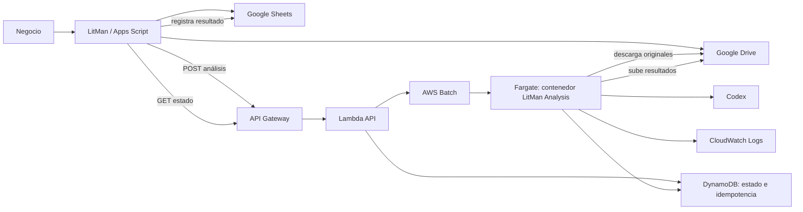

# Plan de integración de LitMan Analysis en AWS

**Estado:** propuesta de arquitectura y plan de ejecución  
**Fecha:** 22 de septiembre de 2026  
**Destinatarios:** dirección, negocio y equipo técnico  
**Objetivo:** mantener LitMan como interfaz e ingestador en Google Workspace y ejecutar los análisis pesados de LitMan Analysis en contenedores bajo demanda en AWS.

---

## 1. Resumen ejecutivo

Actualmente existen dos aplicaciones que funcionan por separado:

- **LitMan**, desplegada en Google Apps Script, ingesta diariamente licitaciones desde PLACSP y Gmail, guarda sus documentos en Google Drive y permite a negocio gestionarlas desde una interfaz web apoyada en Google Sheets.
- **LitMan Analysis**, ejecutado localmente en Python, analiza en profundidad los documentos de una licitación y genera una ficha de oportunidad, un dossier estructurado, un resumen, una propuesta técnica en DOCX y un simulador económico en XLSX.

La propuesta es conservar LitMan como punto de entrada y como interfaz de usuario, y trasladar LitMan Analysis a un contenedor Docker que AWS ejecutará únicamente cuando se solicite un análisis.

El flujo resultante será:

```text
LitMan / Apps Script
        │
        │ Solicita un análisis y recibe un job_id
        ▼
API Gateway + Lambda
        │
        │ Encola un trabajo y responde inmediatamente
        ▼
AWS Batch sobre Fargate
        │
        │ Arranca un contenedor Docker temporal
        ▼
LitMan Analysis
        ├── descarga documentos desde Google Drive
        ├── ejecuta Codex y los análisis
        ├── genera PDF, DOCX, XLSX y JSON
        └── sube los resultados a Google Drive
        │
        ▼
LitMan consulta el estado y muestra los resultados
```

La petición HTTP no permanece abierta durante el análisis. La API responde con `202 Accepted` y un identificador de trabajo. Apps Script consulta periódicamente el estado hasta obtener `SUCCEEDED` o `FAILED`.

La recomendación técnica es utilizar **AWS Batch con ejecución Fargate**:

- AWS Batch aporta cola, estados, reintentos y timeout de trabajos.
- Fargate crea un contenedor aislado por ejecución y lo destruye al terminar.
- No es necesario mantener un servidor o worker permanentemente encendido.
- Los trabajos pueden durar más de los 15 minutos permitidos por AWS Lambda.

La principal incertidumbre que debe resolverse al principio es la autenticación de Codex en un contenedor efímero. Se realizará una prueba específica antes de construir toda la infraestructura.

---

## 2. Alcance

### 2.1 Incluido

El proyecto incluye:

1. Dockerizar LitMan Analysis.
2. Añadir acceso servidor-a-servidor a Google Drive.
3. Implementar dos operaciones asíncronas:
   - análisis inicial y ficha de oportunidad.
   - análisis detallado y generación de resumen, propuesta técnica y simulador económico.
4. Publicar una API para iniciar los trabajos y consultar su estado.
5. Desplegar los trabajos en AWS Batch sobre Fargate.
6. Integrar los nuevos trabajos y resultados en LitMan.
7. Guardar en Drive todos los resultados permanentes.
8. Mantener trazabilidad, logs, versiones y protección frente a duplicados.
9. Proporcionar desarrollo y pruebas locales reproducibles.

### 2.2 Fuera de alcance inicial

No se contempla en esta primera entrega:

- reemplazar la interfaz de Apps Script;
- migrar la ingesta PLACSP o Gmail fuera de Google;
- construir una aplicación React;
- añadir un chat general con la licitación;
- edición de documentos dentro de la interfaz;
- procesamiento paralelo masivo;
- sustituir Drive o Sheets como herramientas de negocio;
- migrar documentos históricos de forma automática, salvo los necesarios para las pruebas.

Estas capacidades podrían añadirse posteriormente sin cambiar la frontera principal de la arquitectura.

---

## 3. Situación actual del repositorio

### 3.1 LitMan Analysis

LitMan Analysis está situado en la raíz del workspace y contiene:

- pipeline Python de análisis inicial y análisis detallado;
- generación de generación;
- normalización de documentos a Markdown;
- schemas JSON y validaciones semánticas;
- proveedor basado en `codex exec`;
- generación de ficha de oportunidad en HTML/PDF;
- generación de resumen y propuesta en DOCX;
- generación de simulador económico en XLSX;
- estructura de ejecuciones auditables en directorios `runs`;
- plantillas, prompts, reglas y casos de prueba versionados como archivos.

Flujo actual:

```text
carpeta local
  → inventario
  → Markdown
  → análisis inicial
  → análisis detallado
  → dossier.json
  → generación
  → DOCX + XLSX + JSON de control
```

La suite de LitMan Analysis tiene actualmente **59 pruebas detectadas: 58 superadas y 1 fallida** en este entorno. La prueba fallida es la validación del PDF de la ficha de oportunidad mediante Google Chrome: el manifiesto se genera, pero el PDF esperado no aparece. Debe resolverse antes de considerar estable la imagen Docker.

### 3.2 LitMan / `automation-commercial-tenders`

El repositorio `automation-commercial-tenders` contiene la aplicación operativa de Apps Script:

- ingesta de PLACSP y Gmail;
- identidad canónica de expedientes;
- descarga y deduplicación de documentos;
- persistencia en Drive y Sheets;
- análisis inicial actual;
- jobs, leases y reintentos;
- workflow comercial;
- dashboard y fichas de expedientes;
- acceso configurable a proveedores LLM.

Este repositorio Git está actualmente limpio sobre su rama `main`.

Sus pruebas Python de referencia no pudieron ejecutarse durante esta revisión porque el entorno no permitió descargar `pypdf` desde PyPI. Esto no demuestra un fallo de la aplicación, pero debe verificarse en un entorno con dependencias instaladas.

### 3.3 Preparación pendiente del workspace

La raíz de LitMan Analysis no es actualmente un repositorio Git. Antes de hacer cambios estructurales se debe decidir una de estas opciones:

1. Convertir la raíz en el repositorio principal y mantener `automation-commercial-tenders` como repositorio separado o submódulo.
2. Mantener ambos repositorios separados y crear la infraestructura de LitMan Analysis únicamente en el repositorio raíz.

La recomendación inicial es **mantenerlos separados**:

- repositorio LitMan Analysis: motor, contenedor, API e infraestructura AWS;
- repositorio LitMan: interfaz Apps Script e integración con la API.

Debe inicializarse Git en LitMan Analysis antes de comenzar el desarrollo y excluir credenciales, ejecuciones, documentos reales y artefactos generados.

El repositorio dispone ya de `Dockerfile` y `compose.yaml`. Cada job local usa un
único contenedor que descarga o copia, normaliza, analiza, valida y publica. La
infraestructura Terraform/CDK y la configuración AWS siguen pendientes.

---

## 4. Arquitectura propuesta



### 4.1 Responsabilidades

| Componente | Responsabilidad |
|---|---|
| LitMan | Interfaz, ingesta, selección de documentos, solicitud de trabajos y presentación de resultados. |
| Google Drive | Repositorio permanente de documentos originales y generados. |
| Google Sheets | Índice operativo y auditoría visible para negocio. |
| API Gateway | Entrada HTTPS, limitación de tráfico y encaminamiento. |
| Lambda API | Validación, autorización, idempotencia, envío a Batch y consulta de estado. |
| DynamoDB | Estado técnico breve del job, progreso e idempotencia. No almacena el expediente completo. |
| AWS Batch | Cola, planificación, reintentos y estados del trabajo. |
| Fargate | CPU, memoria y filesystem temporal para cada contenedor. |
| Contenedor LitMan Analysis | Descarga, análisis, validación, generación y subida de resultados. |
| Secrets Manager | Credenciales de Drive, Codex y firma de la API. |
| CloudWatch | Logs, métricas, alertas y diagnóstico. |

### 4.2 Por qué Lambda no ejecuta LitMan Analysis

AWS Lambda, incluida una Lambda distribuida como imagen Docker, tiene un tiempo máximo habitual de 900 segundos, es decir, 15 minutos. LitMan Analysis puede superar ese tiempo. Por eso Lambda solo realizará operaciones de pocos segundos:

- validar la petición;
- crear un job;
- consultar un job;
- enviar el trabajo a AWS Batch.

Referencia: [cuotas de AWS Lambda](https://docs.aws.amazon.com/lambda/latest/dg/gettingstarted-limits.html).

### 4.3 Por qué AWS Batch sobre Fargate

AWS Batch permite enviar un trabajo de contenedor a una cola y consultar estados normalizados: `SUBMITTED`, `PENDING`, `RUNNABLE`, `STARTING`, `RUNNING`, `SUCCEEDED` y `FAILED`. Fargate ejecuta el contenedor sin mantener servidores EC2.

Referencias:

- [AWS Batch con Fargate](https://docs.aws.amazon.com/batch/latest/userguide/getting-started-with-fargate-using-the-aws-cli.html)
- [timeouts y finalización de jobs](https://docs.aws.amazon.com/batch/latest/userguide/job_timeouts.html)

### 4.4 Alternativa de contingencia: EC2

Si la autenticación de Codex gestionada por la cuenta actual resulta frágil en contenedores efímeros, la alternativa es una instancia EC2 pequeña con un worker Docker persistente. Simplifica la persistencia de `$CODEX_HOME`, pero añade mantenimiento de servidor y coste en reposo.

La decisión Batch/EC2 debe cerrarse después de la prueba de autenticación descrita en la fase 0.

---

## 5. Flujos funcionales

### 5.1 análisis inicial: ficha de oportunidad

1. Negocio abre un expediente en LitMan.
2. LitMan obtiene los `drive_file_id` de los documentos originales vigentes.
3. El usuario pulsa **Ejecutar análisis inicial**.
4. Apps Script llama a la API y recibe `job_id`.
5. LitMan registra el job como pendiente.
6. AWS Batch arranca un contenedor.
7. El contenedor descarga los documentos seleccionados desde Drive.
8. LitMan Analysis normaliza los documentos a Markdown.
9. Codex genera la salida estructurada del análisis inicial.
10. LitMan Analysis valida schema, reglas y evidencias.
11. Se genera `ficha_oportunidad.pdf` y sus JSON de soporte.
12. Los artefactos se suben a Drive.
13. El job termina como `SUCCEEDED`.
14. LitMan detecta la finalización mediante polling.
15. LitMan registra el análisis, evidencias y enlaces a documentos.

Resultados mínimos:

- `result.json`;
- `evidence-index.json`;
- `validation.json`;
- `ficha_oportunidad.pdf`;
- `lineage.json`;
- `manifest.json`.

### 5.2 análisis detallado y generación

1. Negocio solicita **Generar propuesta base**.
2. LitMan envía los documentos originales y el identificador del análisis inicial vigente.
3. El worker descarga documentos y resultado previo.
4. Ejecuta análisis detallado.
5. Valida y guarda `dossier.json`.
6. Ejecuta la generación de generación.
7. Genera los artefactos seleccionados.
8. Sube resultados y manifiesto a Drive.
9. LitMan importa los enlaces y actualiza el expediente.

Resultados mínimos:

- `dossier.json`;
- `content.json`;
- `economic_inputs.json`;
- `coverage.json`;
- `pending.json`;
- `resumen_licitacion.docx`;
- `propuesta_tecnica_base.docx`;
- `simulador_economico.xlsx`;
- `generation_manifest.json`;
- `lineage.json`.

### 5.3 Cierre de la interfaz durante un trabajo

El trabajo no depende de que el navegador permanezca abierto:

- el polling de la pantalla ofrece feedback inmediato;
- un trigger instalable de Apps Script revisa jobs pendientes en segundo plano;
- cuando el usuario vuelve, LitMan consulta y reconcilia los jobs aún abiertos.

Apps Script permite triggers temporales instalables y llamadas HTTPS mediante `UrlFetchApp`:

- [triggers instalables](https://developers.google.com/apps-script/guides/triggers/installable)
- [UrlFetchApp](https://developers.google.com/apps-script/reference/url-fetch/url-fetch-app)

---

## 6. Contrato de API

### 6.1 Principios

- Las operaciones de inicio devuelven `202 Accepted`.
- No se envían PDFs dentro de la petición.
- Se envían identificadores de Drive y metadatos.
- Cada solicitud lleva clave de idempotencia.
- El contrato se define con OpenAPI y schemas JSON.
- Los errores distinguen validación, permisos, infraestructura y análisis.
- No se exponen credenciales ni rutas internas.

### 6.2 Iniciar análisis inicial

```http
POST /v1/expedientes/{expediente_id}/analisis-oportunidad
X-API-Key: ...
X-Litman-Timestamp: 2026-09-22T10:30:00Z
X-Litman-Signature: ...
Content-Type: application/json
```

```json
{
  "drive_folder_id": "1ABC...",
  "documents": [
    {
      "document_id": "doc_123",
      "drive_file_id": "1FILE...",
      "content_hash": "sha256:...",
      "name": "PCAP.pdf"
    }
  ],
  "requested_by": "usuario@empresa.com",
  "force": false,
  "idempotency_key": "assessment:expediente:document-set:versions"
}
```

Respuesta:

```http
HTTP/1.1 202 Accepted
Location: /v1/jobs/job_01K...
```

```json
{
  "job_id": "job_01K...",
  "job_type": "assessment",
  "status": "submitted",
  "status_url": "/v1/jobs/job_01K..."
}
```

### 6.3 Iniciar análisis detallado y generación

```http
POST /v1/expedientes/{expediente_id}/generacion-oferta
```

```json
{
  "drive_folder_id": "1ABC...",
  "documents": [
    {
      "document_id": "doc_123",
      "drive_file_id": "1FILE...",
      "content_hash": "sha256:...",
      "name": "PCAP.pdf"
    }
  ],
  "assessment": {
    "run_id": "assessment23",
    "result_drive_file_id": "1RESULT..."
  },
  "artifacts": [
    "summary",
    "technical-document",
    "economic-simulator"
  ],
  "options": {
    "content_profile": "draft-v1",
    "output_language": "auto",
    "technical_template_id": "next-standard-v1",
    "economic_template_id": "standard-v1"
  },
  "idempotency_key": "detailed-analysis:expediente:inputs:versions"
}
```

### 6.4 Consultar un job

```http
GET /v1/jobs/{job_id}
```

Durante la ejecución:

```json
{
  "job_id": "job_01K...",
  "status": "running",
  "stage": "analyzing",
  "progress": {
    "current": 4,
    "total": 7,
    "message": "Analizando documentos"
  },
  "created_at": "2026-09-22T10:30:00Z",
  "started_at": "2026-09-22T10:30:42Z"
}
```

Al terminar:

```json
{
  "job_id": "job_01K...",
  "status": "succeeded",
  "result": {
    "manifest_drive_file_id": "1MANIFEST...",
    "artifacts": [
      {
        "type": "opportunity-report",
        "name": "ficha_oportunidad.pdf",
        "drive_file_id": "1PDF...",
        "sha256": "..."
      }
    ]
  },
  "finished_at": "2026-09-22T10:52:15Z"
}
```

### 6.5 Estados internos

Estados públicos:

```text
submitted
queued
starting
running
succeeded
failed
cancelled
```

Etapas de progreso:

```text
validating_request
downloading_documents
inventory
normalizing
analyzing_1
rendering_report
analyzing_2
planning_documents
generating_content
rendering_documents
uploading_artifacts
publishing_manifest
```

### 6.6 Idempotencia

La clave debe incluir, como mínimo:

- expediente;
- tipo de job;
- hashes de documentos;
- versiones de prompts, reglas y schemas;
- versiones de plantillas;
- opciones de generación;
- versión de inputs humanos cuando existan.

Una repetición idéntica debe devolver el job existente. `force=true` crea una nueva ejecución explícita.

---

## 7. Integración con Google Drive

### 7.1 Decisión

El contenedor descargará y subirá archivos directamente mediante Drive API. Apps Script enviará IDs, no binarios.

Ventajas:

- evita límites de tamaño de Apps Script y API Gateway;
- reduce tiempos de petición;
- conserva los IDs de documento;
- permite comprobar hashes;
- evita duplicar PDFs en cuerpos HTTP y logs;
- hace reintentable el worker independientemente de la interfaz.

### 7.2 Autenticación recomendada

Crear una service account de Google y darle acceso a la unidad compartida o carpeta raíz de LitMan. Sus credenciales se guardarán en AWS Secrets Manager.

Google admite OAuth servidor-a-servidor mediante service accounts: [documentación oficial](https://developers.google.com/identity/protocols/oauth2/service-account).

Si se utiliza una unidad compartida, las llamadas deberán admitir `supportsAllDrives=true`: [soporte de unidades compartidas](https://developers.google.com/workspace/drive/api/guides/enable-shareddrives).

### 7.3 Prueba obligatoria de permisos

Antes de desarrollar el worker completo se verificará que la identidad técnica puede:

1. listar la carpeta de un expediente;
2. descargar un PDF;
3. crear una subcarpeta;
4. subir JSON, PDF, DOCX y XLSX;
5. actualizar un archivo propio;
6. leer metadatos y hashes;
7. ver los archivos desde la cuenta habitual de negocio.

Si los expedientes están en `Mi unidad` y aparece un problema de propiedad o cuota, se evaluará:

- migrar la raíz a una unidad compartida;
- o usar OAuth con una cuenta técnica de Workspace.

### 7.4 Layout de Drive

Propuesta inicial:

```text
<carpeta expediente>/
├── documentos originales actuales
└── LitMan Analysis/
    ├── assessment/
    │   └── <job_id>/
    │       ├── ficha_oportunidad.pdf
    │       ├── result.json
    │       ├── validation.json
    │       ├── evidence-index.json
    │       ├── lineage.json
    │       └── manifest.json
    ├── detailed-analysis/
    │   └── <job_id>/
    │       ├── dossier.json
    │       ├── validation.json
    │       └── manifest.json
    └── entregables/
        └── <job_id>/
            ├── resumen_licitacion.docx
            ├── propuesta_tecnica_base.docx
            ├── simulador_economico.xlsx
            ├── coverage.json
            ├── pending.json
            └── generation_manifest.json
```

Cada manifiesto contendrá IDs de Drive, SHA-256, versiones, timestamps, job de origen y lineage.

### 7.5 Publicación transaccional

Para no publicar una ejecución incompleta:

1. crear carpeta de job con estado `uploading`;
2. subir artefactos y verificar tamaño/hash;
3. subir `manifest.json` al final;
4. considerar publicada únicamente una ejecución con manifiesto válido;
5. si falla, conservar la carpeta como incompleta para diagnóstico y marcar el job `failed`.

---

## 8. Autenticación de Codex

### 8.1 Situación actual

LitMan Analysis utiliza `codex exec` y admite exclusivamente dos modos: sesión ChatGPT persistida en `$CODEX_HOME/auth.json` y API key leída desde un archivo secreto.

### 8.2 Riesgo

Los contenedores Fargate son efímeros. Si Codex renueva la sesión, el `auth.json` actualizado debe conservarse. Dos ejecuciones simultáneas podrían además competir por la misma credencial.

La documentación oficial de OpenAI permite usar `codex exec` en automatización, pero recomienda API key como opción predeterminada. Reutilizar autenticación de ChatGPT mediante `auth.json` se considera una vía avanzada; el archivo debe tratarse como una contraseña y persistirse tras posibles actualizaciones.

Referencias:

- [OpenAI Docs: modo no interactivo](https://learn.chatgpt.com/docs/non-interactive-mode)
- [OpenAI Docs: variables de entorno de Codex](https://learn.chatgpt.com/docs/config-file/environment-variables)

### 8.3 Prueba de viabilidad previa

Crear una imagen mínima que:

1. reciba una copia segura de `auth.json`;
2. configure un `CODEX_HOME` privado y persistente durante las pruebas;
3. ejecute `codex exec --ephemeral --json` sobre un expediente de prueba;
4. verifique salida estructurada;
5. compruebe si `auth.json` cambia;
6. ejecute una segunda vez usando el archivo persistido;
7. documente caducidad y comportamiento de renovación.

### 8.4 Opciones de producción

Orden recomendado:

1. Sesión ChatGPT mediante auth.json, usando EFS como CODEX_HOME persistente o sincronización segura con Secrets Manager.
2. CODEX_API_KEY, alternativa sin estado de sesión.
3. Worker EC2 persistente, como contingencia si el comportamiento en Fargate no resulta fiable.

Para un piloto que reutilice la cuenta actual puede utilizarse la opción 3, con concurrencia máxima de un job Codex. No debe construirse el resto del despliegue antes de validar este punto.

### 8.5 Protección

- Nunca incluir credenciales en la imagen Docker.
- Nunca escribir secretos en CloudWatch.
- No pasar `auth.json` como argumento de comandos.
- Recuperarlo desde Secrets Manager hacia un archivo con permisos restrictivos.
- Ejecutar Codex dentro del contenedor endurecido; no existe un sandbox interno de Codex.
- Rotar la credencial si existe cualquier exposición.

AWS recomienda Secrets Manager o Parameter Store para credenciales: [gestión de secretos en ECS](https://docs.aws.amazon.com/AmazonECS/latest/developerguide/specifying-sensitive-data.html).

---

## 9. Diseño del contenedor

### 9.1 Contenido

La imagen incluirá:

- Python 3.11;
- paquete `litman_analysis`;
- Codex CLI en una versión fijada;
- dependencias de `pyproject.toml` y lockfile;
- prompts, schemas, reglas y plantillas;
- fuentes necesarias para DOCX/PDF;
- Google Chrome/Chromium o una alternativa fijada para la ficha PDF;
- opcionalmente LibreOffice si se introduce conversión de DOCX a PDF.

No incluirá:

- documentos de licitaciones;
- runs históricos;
- credenciales;
- API keys;
- configuración específica de producción.

### 9.2 Entrypoint

```text
python -m litman_analysis.worker run --job-file /work/job.json
```

El mismo contenedor ejecutará ambos tipos de trabajo según `job_type`:

```json
{
  "job_id": "job_01K...",
  "job_type": "assessment",
  "expediente_id": "EXP-2026-001",
  "drive_folder_id": "...",
  "documents": []
}
```

### 9.3 Directorios internos

```text
/app            código y recursos inmutables
/work/job.json  especificación del trabajo
/work/input     documentos descargados
/work/run       ejecución de LitMan Analysis
/work/output    artefactos preparados para subir
/codex-home     autenticación temporal, no incluida en outputs
```

### 9.4 Usuario y permisos

- Ejecutar como usuario no root.
- `/app` en solo lectura.
- Escritura únicamente en `/work` y `/codex-home`.
- No montar el socket Docker.
- Limitar CPU, memoria y almacenamiento.
- Establecer timeout de proceso además del timeout de Batch.

### 9.5 Recursos iniciales

Punto de partida a validar con métricas:

- 2 vCPU;
- 4–8 GiB de RAM;
- 20 GiB de almacenamiento efímero;
- timeout de 120 minutos;
- un intento automático para fallos de infraestructura;
- sin reintento automático para errores de schema, permisos o documentación.

Fargate ofrece 20 GiB temporales por defecto y permite ampliarlos: [almacenamiento temporal de Fargate](https://docs.aws.amazon.com/AmazonECS/latest/developerguide/fargate-task-storage.html).

---

## 10. Desarrollo local

El desarrollo local debe funcionar en capas. Nadie debería necesitar AWS o Drive real para ejecutar la mayoría de pruebas.

### 10.1 Prerrequisitos

- Git;
- Docker y Docker Compose;
- Python 3.11;
- `uv`;
- Codex CLI autenticado para pruebas reales;
- opcionalmente AWS CLI;
- opcionalmente credencial de Drive de desarrollo.

El entorno revisado ya dispone de Docker, `uv` y Codex CLI.

### 10.2 Preparación del repositorio

1. Inicializar Git para LitMan Analysis.
2. Crear `.gitignore` para:
   - `.venv/`;
   - `runs/`;
   - documentos de expedientes;
   - `*.log`;
   - `.env`;
   - credenciales Google/OpenAI/AWS;
   - outputs locales;
   - caches de tests.
3. Crear ramas de trabajo pequeñas.
4. No mover ni borrar los expedientes existentes.
5. Registrar la línea base de pruebas.

### 10.3 Abstracciones antes de Docker

Introducir interfaces sin alterar inicialmente el pipeline actual:

```text
DocumentSource
├── LocalDocumentSource
└── GoogleDriveDocumentSource

ArtifactDestination
├── LocalArtifactDestination
└── GoogleDriveArtifactDestination

JobStateStore
├── LocalJobStateStore
└── DynamoJobStateStore

JobLauncher
├── LocalDockerJobLauncher
└── AwsBatchJobLauncher
```

Los servicios actuales de análisis no deben importar SDKs de Drive, AWS o Lambda. Recibirán paths locales y continuarán siendo testeables como hoy.

### 10.4 Worker local con filesystem

Primera ejecución sin Drive ni AWS:

```bash
uv run python -m litman_analysis.worker run-local \
  --job-type assessment \
  --case-dir "licitaciones/presentadas/260828 BI - UIB (206k)" \
  --output-dir /tmp/litman-analysis-output \
  --deterministic
```

Objetivo:

- verificar inventario y normalización;
- crear estructura de job;
- generar resultado determinista;
- publicar manifiesto local;
- no usar Codex, Drive ni AWS.

Después:

```bash
uv run python -m litman_analysis.worker run-local \
  --job-type assessment \
  --case-dir "licitaciones/presentadas/260828 BI - UIB (206k)" \
  --output-dir /tmp/litman-analysis-codex-output
```

Esta segunda prueba utiliza Codex real y compara los resultados con la ejecución CLI existente.

### 10.5 Construcción Docker

```bash
docker build -t litman-analysis-worker:dev .
```

Prueba determinista:

```bash
docker run --rm \
  --mount type=bind,src="$PWD/licitaciones/presentadas/260828 BI - UIB (206k)",dst=/work/input,readonly \
  --mount type=bind,src=/tmp/litman-analysis-docker-output,dst=/work/output \
  litman-analysis-worker:dev \
  python -m litman_analysis.worker run-mounted \
    --job-type assessment \
    --input /work/input \
    --output /work/output \
    --deterministic
```

Prueba con Codex:

1. Crear un directorio temporal de credenciales fuera del repositorio.
2. Copiar allí únicamente los archivos requeridos por Codex.
3. Montarlo en `/codex-home`.
4. Definir `CODEX_HOME=/codex-home`.
5. Ejecutar el contenedor con red y documentos en solo lectura.
6. Destruir el directorio temporal después de verificar la persistencia segura.

Nunca copiar credenciales al contexto de `docker build`.

### 10.6 Prueba local de Drive

Crear una carpeta de Drive exclusiva de desarrollo con documentos no sensibles.

```bash
docker run --rm \
  --env DRIVE_FOLDER_ID="<carpeta-prueba>" \
  --env GOOGLE_APPLICATION_CREDENTIALS=/run/secrets/google.json \
  --mount type=bind,src=/ruta-segura/google-dev.json,dst=/run/secrets/google.json,readonly \
  litman-analysis-worker:dev \
  python -m litman_analysis.worker smoke-drive
```

La prueba debe:

- listar;
- descargar;
- comprobar hash;
- subir un JSON y un DOCX de muestra;
- verificar metadatos;
- limpiar únicamente los artefactos creados por la propia prueba.

### 10.7 API local

Proporcionar un servidor local de desarrollo que reutilice los schemas de la Lambda:

```bash
uv run uvicorn litman_analysis.api.local:app --reload --port 8080
```

En local, `JobLauncher` ejecutará Docker mediante un adaptador explícito de desarrollo. No se utilizará el socket Docker dentro del contenedor de producción.

Prueba:

```bash
curl -X POST http://localhost:8080/v1/expedientes/demo/analisis-oportunidad \
  -H 'Content-Type: application/json' \
  -d @tests/fixtures/api/assessment-request.json
```

Después:

```bash
curl http://localhost:8080/v1/jobs/<job_id>
```

### 10.8 Simulación de Apps Script

Antes de modificar la UI, crear una función de diagnóstico que:

1. llame al API local mediante una URL temporal segura o al entorno AWS de desarrollo;
2. conserve el `job_id`;
3. consulte estado;
4. muestre el JSON en logs;
5. no modifique expedientes reales.

No es necesario emular Apps Script dentro de Docker.

---

## 11. Estrategia de pruebas

### 11.1 Pruebas unitarias

- validación de requests;
- creación de claves de idempotencia;
- transición de estados;
- clasificación de errores;
- construcción del manifiesto;
- nombres y rutas seguras;
- selección de documentos originales;
- traducción entre resultado LitMan Analysis y registros LitMan;
- mocks de Drive y AWS Batch;
- protección contra path traversal y nombres maliciosos.

### 11.2 Pruebas de contrato

- OpenAPI contra request/response reales;
- schema del job interno;
- schema de `manifest.json`;
- compatibilidad del resultado de análisis inicial;
- compatibilidad de `dossier.json`;
- compatibilidad de artefactos de generación;
- contrato entre LitMan y la API.

### 11.3 Pruebas de integración locales

- pipeline determinista dentro de Docker;
- pipeline con proveedor falso;
- pipeline con Codex real, marcado como opt-in;
- generación real de PDF, DOCX y XLSX;
- descarga/subida contra carpeta Drive de desarrollo;
- fallo deliberado a mitad de upload;
- reintento idempotente;
- ejecución con archivo corrupto o sin texto.

### 11.4 Pruebas end-to-end AWS

1. Publicar imagen en un entorno `dev`.
2. Enviar análisis inicial sobre un expediente de prueba.
3. Verificar estados de Batch.
4. Verificar logs sin secretos.
5. Verificar artefactos en Drive.
6. Repetir la misma petición y comprobar idempotencia.
7. Lanzar análisis detallado y generación.
8. Forzar un error de permisos Drive.
9. Forzar un timeout corto.
10. Cerrar la UI durante el trabajo y verificar reconciliación posterior.

### 11.5 Pruebas de aceptación con negocio

- El botón responde en pocos segundos.
- La pantalla muestra que el trabajo está en cola o ejecutándose.
- El usuario puede cerrar y volver sin perder el trabajo.
- Un doble clic no crea dos análisis equivalentes.
- Los resultados aparecen en la carpeta correcta de Drive.
- LitMan enlaza todos los artefactos.
- Un fallo indica causa y acción recomendada.
- La ficha de oportunidad conserva evidencias.
- Los DOCX y XLSX se abren correctamente en Google Drive y escritorio.
- Los outputs no sobrescriben ediciones previas.

---

## 12. Infraestructura AWS

### 12.1 Recursos mínimos

- ECR repository para la imagen;
- API Gateway REST API;
- Lambda `submit-analysis-job`;
- Lambda `get-analysis-job` o una única Lambda con routing;
- DynamoDB `litman-analysis-jobs`;
- AWS Batch Fargate compute environment;
- AWS Batch job queue;
- AWS Batch job definition;
- Secrets Manager;
- CloudWatch Log Group;
- IAM roles separadas;
- VPC, subredes y salida HTTPS.

### 12.2 Infraestructura como código

Elegir una sola herramienta:

- AWS CDK si el equipo prefiere Python/TypeScript;
- Terraform si ya existe estándar corporativo.

No crear recursos de producción manualmente salvo el bootstrap inicial. Los entornos serán:

```text
dev
prod
```

Cada uno tendrá colas, secretos, tablas y log groups separados.

### 12.3 IAM mínimo

Lambda API:

- `batch:SubmitJob`;
- `batch:DescribeJobs`;
- acceso limitado a la tabla DynamoDB;
- escritura de logs.

Batch execution role:

- descargar imagen de ECR;
- escribir logs.

Batch task role:

- leer secretos concretos;
- actualizar el job correspondiente en DynamoDB;
- opcionalmente actualizar la versión de la credencial Codex;
- sin permisos para administrar infraestructura.

### 12.4 Networking

El contenedor necesita salida HTTPS hacia:

- Google OAuth y Drive API;
- OpenAI/Codex;
- servicios AWS regionales.

No necesita endpoint público entrante. Debe evaluarse el coste de NAT Gateway frente a subred pública con IP pública y reglas estrictas para un piloto de bajo volumen.

### 12.5 Secretos

Secretos separados:

```text
/litman-analysis/dev/google-drive-service-account
/litman-analysis/dev/codex-auth
/litman-analysis/dev/litman-hmac
```

Y equivalentes para producción. No reutilizar secretos de `dev` en `prod`.

### 12.6 Observabilidad

Cada log incluirá:

```text
job_id
expediente_id
job_type
stage
run_id
correlation_id
duration_ms
```

Nunca incluirá:

- contenido completo de documentos;
- tokens;
- claves privadas;
- prompts con información sensible salvo política explícita;
- `auth.json`.

Alarmas iniciales:

- jobs `FAILED`;
- job en `RUNNING` más de 120 minutos;
- errores de autenticación Drive;
- errores de autenticación Codex;
- cola con trabajos antiguos;
- Lambda con errores 5xx.

---

## 13. Cambios en LitMan

### 13.1 Backend Apps Script

Crear un módulo, por ejemplo `remote_analysis.js`, con:

- configuración del endpoint;
- firma/autenticación;
- envío de análisis inicial;
- envío de análisis detallado/generación;
- consulta de estado;
- traducción de errores;
- reconciliación de jobs pendientes;
- importación de artefactos y manifiestos.

No mezclar la implementación AWS dentro de `analysis.js`. La lógica existente puede mantenerse durante la transición detrás de un feature flag.

### 13.2 Modelo Jobs

Reutilizar la tabla `Jobs` actual y añadir, si faltan:

```text
remote_provider
remote_job_id
remote_status
remote_stage
remote_status_url
last_polled_at
result_manifest_drive_file_id
```

### 13.3 UI

En la ficha:

- botón **Ejecutar análisis inicial**;
- botón **Generar propuesta base**;
- estado visible;
- etapa y mensaje;
- tiempo transcurrido;
- botón reintentar;
- enlaces a artefactos;
- historial de ejecuciones.

Desactivar el botón si existe un job equivalente activo.

### 13.4 Polling

- Polling en pantalla cada 5–10 segundos mientras esté abierta.
- Backoff si el job dura mucho.
- Trigger instalable cada minuto o intervalo permitido para reconciliar jobs activos.
- Dejar de consultar estados terminales.
- Si AWS no responde, mantener `unknown`/`temporarily_unavailable`, no marcar `failed` inmediatamente.

### 13.5 Importación de resultados

Al detectar `succeeded`:

1. verificar `manifest_drive_file_id`;
2. leer y validar el manifiesto;
3. hacer upsert en `Analisis`;
4. hacer upsert en `Documentos` para artefactos;
5. registrar evidencias y campos cuando corresponda;
6. actualizar `analisis_vigente_id`;
7. registrar evento de auditoría;
8. marcar el job completado.

Esta operación también debe ser idempotente.

---

## 14. Seguridad de la API

Para el piloto se puede utilizar API key, pero AWS advierte que las API keys de API Gateway están orientadas a cuotas e identificación, no deben ser el único mecanismo de autorización: [documentación AWS](https://docs.aws.amazon.com/apigateway/latest/developerguide/api-gateway-api-usage-plans.html).

Propuesta inicial:

- API key de API Gateway;
- timestamp;
- nonce o `job_request_id`;
- firma HMAC del método, path, timestamp y hash del body;
- rechazo de timestamps antiguos;
- secreto en Script Properties y Secrets Manager;
- rate limit bajo;
- logs sin headers secretos.

Más adelante puede sustituirse por IAM SigV4 o un Lambda Authorizer más completo.

---

## 15. Tratamiento de errores y reintentos

### 15.1 Errores reintentables

- timeout temporal de Drive;
- `429` de APIs externas;
- fallo temporal de red;
- indisponibilidad de capacidad Fargate;
- error 5xx transitorio.

### 15.2 Errores no reintentables automáticamente

- documento inexistente o sin permisos;
- credencial revocada;
- schema inválido tras agotar la reparación prevista;
- dossier incompatible;
- plantilla inexistente;
- hash distinto del declarado;
- configuración inválida;
- expediente sin documentos.

### 15.3 Publicación parcial

Un job fallido no debe aparecer como completado aunque haya subido algunos archivos. El manifiesto final es el indicador de publicación completa.

### 15.4 Cancelación

No es imprescindible en la primera versión, pero el modelo deberá admitir `cancelled`. AWS Batch permite terminar jobs; puede añadirse después como botón de administrador.

---

## 16. Fases de ejecución

### Fase 0 — Decisiones y pruebas de riesgo

**Objetivo:** resolver incertidumbres antes de desarrollar infraestructura.

Tareas:

1. Inicializar/versionar LitMan Analysis.
2. Corregir la prueba PDF actual.
3. Ejecutar suite completa de ambos repositorios.
4. Confirmar unidad compartida o modelo de Drive.
5. Crear carpeta Drive de desarrollo.
6. Probar service account con Drive.
7. Probar Codex dentro de Docker con la credencial actual.
8. Determinar si `auth.json` cambia y cómo persistirlo.
9. Medir duración, memoria, tamaño de disco y tráfico de dos expedientes reales anonimizados.
10. Cerrar decisión de autenticación Codex y Batch frente a EC2.

**Criterio de salida:** un contenedor local completa análisis inicial usando documentos descargados de Drive y sube resultados de prueba.

### Fase 1 — Worker local y Docker

1. Definir modelo de job y manifiesto.
2. Crear interfaces de documentos, artefactos y estado.
3. Implementar adaptadores locales.
4. Crear worker CLI.
5. Crear Dockerfile reproducible.
6. Fijar versión de Codex y dependencias.
7. Ejecutar análisis inicial determinista y real.
8. Ejecutar análisis detallado + generación.
9. Añadir tests y documentación.

**Criterio de salida:** ambos jobs funcionan dentro de Docker contra filesystem local.

### Fase 2 — Drive

1. Implementar cliente Drive.
2. Descargar todos los archivos directos de la carpeta de entrada.
3. Verificar hashes.
4. Subir artefactos.
5. Crear carpetas y manifiestos.
6. Manejar unidades compartidas.
7. Añadir pruebas de integración opt-in.

**Criterio de salida:** Docker recibe IDs de Drive y publica una ejecución completa sin intervención manual.

### Fase 3 — API asíncrona local

1. Especificar OpenAPI.
2. Implementar validación y errores.
3. Implementar idempotencia.
4. Crear launcher local.
5. Implementar consulta de estado.
6. Probar doble clic, reintentos y fallo.

**Criterio de salida:** `POST` responde inmediatamente y `GET` refleja un contenedor local hasta su finalización.

### Fase 4 — AWS de desarrollo

1. Infraestructura como código.
2. ECR.
3. Batch/Fargate.
4. DynamoDB.
5. Lambda y API Gateway.
6. Secrets Manager.
7. CloudWatch.
8. IAM mínimo.
9. Pipeline de build y despliegue.
10. Prueba end-to-end.

**Criterio de salida:** ambos endpoints funcionan en `dev` y publican resultados en Drive de desarrollo.

### Fase 5 — Integración LitMan

1. Feature flag para análisis remoto.
2. Cliente HTTP Apps Script.
3. Botones y estados.
4. Persistencia de job remoto.
5. Polling UI.
6. Trigger de reconciliación.
7. Importación idempotente.
8. Historial y enlaces.
9. Pruebas `/dev` de Apps Script.

**Criterio de salida:** negocio completa el flujo desde LitMan sin usar terminal.

### Fase 6 — Piloto y producción

1. Seleccionar 3–5 licitaciones representativas.
2. Comparar local frente a AWS.
3. Revisar calidad y tiempos.
4. Ajustar recursos y timeout.
5. Crear runbook.
6. Configurar alertas y costes.
7. Desplegar producción.
8. Mantener el análisis antiguo como rollback temporal.
9. Retirarlo tras aceptación.

**Criterio de salida:** flujo aceptado por negocio, observabilidad activa y rollback probado.

---

## 17. Estimación orientativa

Para una persona con conocimiento del código pero sin infraestructura previa preparada:

| Fase | Estimación |
|---|---:|
| Fase 0: pruebas de riesgo | 3–5 días |
| Fase 1: worker y Docker | 5–8 días |
| Fase 2: Drive | 4–6 días |
| Fase 3: API local | 3–5 días |
| Fase 4: AWS dev | 5–8 días |
| Fase 5: integración LitMan | 5–8 días |
| Fase 6: piloto/producción | 4–6 días |
| **Total orientativo** | **29–46 días laborables** |

La horquilla depende principalmente de:

- autenticación Codex;
- permisos/propiedad en Drive;
- estabilidad de DOCX/PDF dentro de Linux;
- cambios necesarios en el schema de LitMan;
- requisitos corporativos de AWS, red e IAM.

No se recomienda comprometer una fecha cerrada antes de completar la fase 0.

---

## 18. Riesgos principales

| Riesgo | Impacto | Mitigación |
|---|---|---|
| La sesión local de Codex no se renueva bien en Fargate | Alto | Spike temprano; access token/API key; Secrets Manager; EC2 como contingencia. |
| Drive no permite subir con service account en la estructura actual | Alto | Unidad compartida o cuenta técnica OAuth; prueba previa. |
| El PDF no se renderiza de forma reproducible | Medio/alto | Fijar navegador/fuentes; corregir test existente; smoke test en imagen final. |
| Doble clic crea trabajos duplicados | Medio | Idempotency key y restricción LitMan. |
| Un job termina pero LitMan no lo importa | Medio | Trigger de reconciliación y manifiesto permanente en Drive. |
| Upload parcial | Medio | Publicar manifiesto al final y validar hashes. |
| Coste inesperado por red/NAT o análisis largos | Medio | Métricas por job, presupuesto AWS, límites y revisión tras piloto. |
| Documentos sensibles aparecen en logs | Alto | Logging estructurado sin contenido; revisión de seguridad. |
| Reintento duplica artefactos | Medio | Carpetas por job e idempotencia en upload/importación. |
| La raíz LitMan Analysis no está versionada | Alto | Inicializar Git antes del primer cambio. |

---

## 19. Operación y soporte

### 19.1 Runbook mínimo

Debe documentar:

- cómo desplegar una imagen nueva;
- cómo volver a una versión anterior;
- cómo reintentar un job;
- cómo cancelar un job;
- cómo renovar credenciales;
- cómo verificar permisos Drive;
- dónde consultar logs;
- cómo reconciliar un resultado no importado;
- cómo identificar un job por expediente;
- cómo actuar ante timeout o cuota.

### 19.2 Versiones

Cada job registrará:

- versión Git de LitMan Analysis;
- digest de imagen Docker;
- versión de Codex CLI;
- modelo solicitado;
- prompt, schema, reglas y plantillas;
- hashes de documentos de entrada;
- IDs de Drive;
- opciones de generación.

### 19.3 Retención

- Drive: resultados permanentes según política de negocio.
- Sheets: índice e historial visible.
- DynamoDB: estado técnico con TTL, por ejemplo 30–90 días.
- CloudWatch: retención explícita, no infinita por defecto.
- Workspace temporal Fargate: eliminado al terminar.

---

## 20. Decisiones pendientes

Antes de iniciar producción deben confirmarse:

1. ¿Los expedientes están en unidad compartida o `Mi unidad`?
2. ¿Existe permiso administrativo para crear service account y compartir Drive?
3. ¿Qué credencial de Codex se autoriza para producción?
4. ¿Se permite guardar `auth.json` cifrado en AWS como solución temporal?
5. ¿Se admite limitar a un solo análisis simultáneo inicialmente?
6. ¿CDK o Terraform es el estándar de infraestructura?
7. ¿Región AWS autorizada?
8. ¿Tiempo máximo esperado por análisis?
9. ¿Política de retención de documentos y logs?
10. ¿Qué campos del análisis inicial sustituyen exactamente el análisis actual de LitMan?
11. ¿La propuesta técnica inicial será `skeleton-v1` o `draft-v1`?
12. ¿Se requiere PDF de la propuesta o solo DOCX?

---

## 21. Primeros pasos recomendados

Orden inmediato:

1. Inicializar Git para LitMan Analysis y capturar el estado actual.
2. Corregir la prueba de generación PDF.
3. Crear un Dockerfile mínimo que ejecute las pruebas.
4. Ejecutar un análisis inicial determinista dentro de Docker.
5. Ejecutar Codex dentro de Docker con una copia segura de la sesión actual.
6. Crear y probar una identidad técnica de Drive.
7. Descargar un expediente de prueba, analizarlo y volver a subir el resultado.
8. Medir duración, memoria y disco.
9. Confirmar Batch/Fargate o activar la contingencia EC2.
10. Solo entonces implementar la API y modificar LitMan.

El primer hito demostrable debe ser:

```text
Un comando Docker recibe IDs de Drive,
descarga un expediente,
ejecuta análisis inicial,
genera la ficha de oportunidad
y la vuelve a guardar en Drive.
```

Hasta completar ese hito no es necesario construir la UI, API Gateway ni el entorno completo de AWS.

---

## 22. Conclusión

La propuesta mantiene las dos inversiones ya realizadas:

- LitMan continúa siendo la herramienta diaria de negocio y el sistema de ingesta.
- LitMan Analysis continúa siendo el motor especializado de análisis y generación.

La integración se realiza mediante trabajos asíncronos y documentos de Drive, sin trasladar PDFs en las llamadas HTTP ni mantener conexiones abiertas.

AWS Batch sobre Fargate es la opción más ajustada porque ejecuta un contenedor por solicitud, no consume capacidad permanente y aporta cola, estados, reintentos y timeout. Lambda se conserva como capa ligera de API, no como motor de análisis.

El plan reduce el riesgo mediante un orden deliberado: primero validar Docker, Codex y Drive; después construir AWS; finalmente integrar la interfaz. La autenticación de Codex es la decisión técnica que más puede afectar al diseño y debe resolverse como primer spike, no al final del proyecto.
